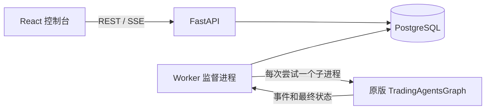

# Phase 2 · Web 控制台实施方案

本方案基于 `9fa1196fffbcfd9de5146d2dd2869df84ab99838` 的[执行链路](upstream-analysis.md)及[扩展点评估](extension-points.md)。复用原版研究流程与角色。交付 FastAPI、React + TypeScript + Vite + Ant Design、PostgreSQL 和 Docker Compose。后续 A 股数据与 KLineChart/ECharts、专项工作流、历史回放按交接路线进入各自阶段。

## 研究适配

在 `server/research/runner.py` 中复用 Graph 构造、`create_run_state`、`Propagator.get_graph_args` 和 `run_rating`。CLI 的流式路径提供参考。`stream_run` 的公开消息/状态格式继续由现有调用者使用。Web 需要节点开始、结束和错误，优先验证对 `graph.graph.stream(..., subgraphs=True, stream_mode=["values", "tasks"])` 的薄适配，按 `stream_run` 做 run_config_context 与关闭处理，最后只用顶层 values 构建规范报告。若原始任务流无法稳定读取，考虑在 `trading_graph.py` 增加可选原始事件适配入口并保留旧接口。先用 ScriptedModel 验证实际事件结构，再锁定版本。

构造模型注入模型回调，调用配置注入工具回调。用实际 namespace、task id、run_id 和 parent_run_id 关联事件，时间线允许并发交错。顶层 values 可能重复消息，按来源和 ID 去重；只用观测到的事件驱动状态。模型 usage 缺失时标记未知；工具结论区分成功、无数据、不可用和异常。对于情绪预取等直接调用，先展示所属节点，有明确记录的供应商调用再增加摘要。仅保留白名单字段及有界脱敏摘要，报告输出经安全渲染。

## 任务与持久化

- PostgreSQL 保存 `research_tasks`（尝试 ID、重试来源、输入和配置快照、状态、错误、租约及执行时间）、`research_events`（task_id + sequence 主键）、`research_reports`（task_id 唯一、版本化 JSON、评级、各报告与证据引用）及服务端配置档。配置快照记录代码/流程版本、模型、轮次、数据源、时区及可用证据；无来源或快照时标明缺失。凭据只保存引用。
- API 创建 PENDING 后立即返回。独立 worker 事务领取并发放租约，监督子进程与心跳。首版一个活跃 worker 槽，保留原版分析师并行；由 PostgreSQL 行锁和租约令牌保证唯一领取和陈旧写入被拒。PID 或退出回执只在所属 worker 内用于确认进程状态。宿主重启后旧执行确认退出才可关闭执行，租约失效记录中断并以 FAILED 结束；新尝试由明确重试创建。
- PENDING 可原子取消。RUNNING → CANCELLING 后，确认子进程退出再写 CANCELLED。阻塞调用先予有限退出时间，过期后结束进程及其子进程。若无法确认退出，保持 CANCELLING 并暴露原因。取消与成功使用条件更新竞争，已终结状态不可反转。SSE 断开只影响订阅。
- 报告、终态及终态事件同一事务提交。尝试使用独立结果/缓存目录，MVP 默认关闭 SQLite checkpoint。重试复制输入快照并关联旧尝试，独立运行。原版 Memory 使用持久卷和单写者，并与成功事务同时登记待投递记录。监督进程成功提交后重放投递，在下次研究前处理剩余记录。复用 `TradingMemoryLog.store_decision` 的同证券同日去重规则，首份决策进入 Memory，所有成功尝试的报告分别留在 PostgreSQL。验证进程中断导致部分追加时的检测与修复。结算仍由原版 Memory 节点执行，取消期间可能已结算旧记录。
- SSE 以数据库事件为事实来源。单写入路径事务分配递增 sequence，SSE id 使用 sequence；首次补发以及 Last-Event-ID 重连均按 `sequence > cursor` 查询，随后继续拉取，终态后发送剩余事件再关闭。用心跳维持代理连接，断开不丢历史；UI 按序号去重。事件含 taskId、sequence、timestamp、type、node、agent、tool、status、durationMs、payload、error，未知字段可空。

## API 与页面

| 合同 | 行为 |
| --- | --- |
| POST /api/research/tasks | 校验代码、研究日期、分析师非空且去重、研究轮数和模型配置档；返回 202 和 taskId。代码沿用原版输入和规范化，行情覆盖以实际来源为准 |
| GET /api/research/tasks、GET /api/research/tasks/{id} | 分页、状态/标的过滤；详情返回输入快照、时间、异常和重试关联 |
| GET /api/research/tasks/{id}/events | SSE 按游标重放并继续订阅 |
| GET /api/research/tasks/{id}/report | 成功后返回分析师文本、多空、研究计划、Trader、风险讨论、最终决策和评级；未就绪返回明确状态 |
| POST /api/research/tasks/{id}/cancel、/retry | 按状态校验；重试返回新 taskId；用幂等键防止重复创建 |
| GET/PATCH /api/settings | 管理服务端配置档、两档模型、Base URL、数据源、研究深度和日志级别。服务端验证允许的端点，凭据在浏览器端不可读 |

控制台提供标的、日期、分析师、研究深度和模型选择；监控页展示并行节点、模型和工具摘要、错误及耗时；报告页按原版字段分节，清楚展示 REVIEW、未选择的分析师与缺失信息；历史页展示可筛选的状态、快照和尝试链；设置页提供模型/数据源和系统分区。个人部署以同源访问为默认，允许远程访问时同时配置身份校验与任务权限。

## 实施顺序与验收

| 顺序 | 拟增文件 | 验证 |
| --- | --- | --- |
| 1. 跑通研究与事件 | `server/research/runner.py`、`server/research/events.py`、`tests/test_web_runner.py` | fake 模型/数据跑完整原图；核对并行、工具上限、usage 未知、异常、报告评级与 `propagate` 一致 |
| 2. 建立持久任务 | `server/api.py`、`server/worker.py`、`server/db/`、`tests/test_web_tasks.py` | PostgreSQL 迁移、并发领取、worker 被杀、终态竞争、重复重试、重启历史、SSE 断线补发、Memory 失败恢复 |
| 3. 浏览器闭环 | `web/src/`、`web/package.json` | UI 创建、节点实时变化、报告、失败、取消和重试；刷新与重连无漏读；脱敏和报告渲染测试 |
| 4. 独立部署和回归 | `compose.web.yml`、`server/Dockerfile`、`web/Dockerfile` | 从空库部署与重启；原 CLI/Python API 回归；凭据可用后至少一次明确标注的真实模型与数据集成。锁定通过验证的 Python/Node 与依赖版本 |

拟依赖 FastAPI 和 ASGI server 用于 REST/SSE，PostgreSQL 驱动及迁移工具用于任务一致性与升级，前端依赖为已确认栈。本阶段仅记录设计，具体版本在 Phase 2 最小链路验证后锁定。
