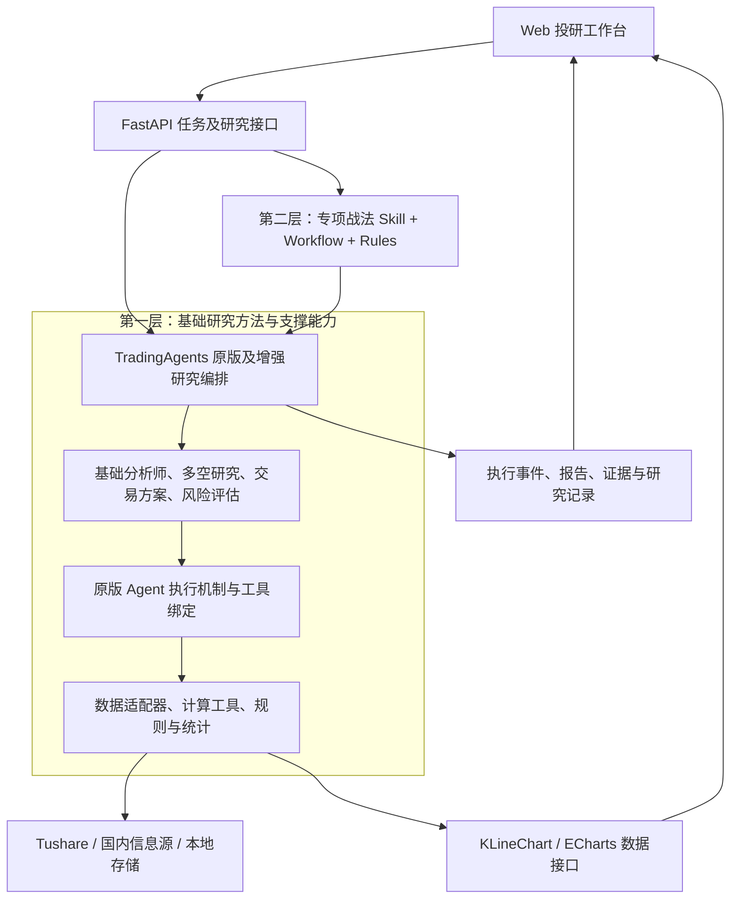

# TradingAgents-Ashares：A 股 AI 投研工作台 Codex 项目交接文档

> 状态：需求与总体技术路线已确定，尚未开始源码改造。本文是本地 Codex 的项目上下文和实施约束，不是已完成的代码审计报告。

## 1. 项目定位

基于 TauricResearch/TradingAgents 原版进行二次开发，构建面向 A 股的个人 AI 投研与操盘辅助工作台。AI 辅助研究，用户最终决定交易；不以自动下单为当前目标，不承诺策略盈利。

- 上游：https://github.com/TauricResearch/TradingAgents
- 用户 Fork：https://github.com/liushuai37/TradingAgents-Ashares
- SSH Clone：`git@github.com:liushuai37/TradingAgents-Ashares.git`
- 基准分支、commit SHA：Phase 1 在本地核实并记录
- 开发原则：最大限度复用原版金融角色、ReAct 风格执行逻辑、LangGraph 编排与研究流程；新增能力尽量独立，避免不必要的通用 Harness 重建。
- 不采用 TradingAgents-CN 或 Trading-R1 作为项目基座。Hermes Agent、DeepSeek Harness 只作为扩展机制的架构参考。

## 2. 核心业务架构：两层研究体系

### 第一层：基础研究方法层

包含数据获取渠道、基础计算能力和基础研究方法。TradingAgents 是此层基础研究方法的主要实现者，同时提供第二层所需的 Agent 协作和研究编排能力。不是另写一套基础分析师，再让 TradingAgents 仅作为消费者。

| 能力 | 原版复用/拟扩展方向 |
| --- | --- |
| 技术与量价分析 | 复用行情分析师，适配 K 线、多周期、均线、MACD、RSI、KDJ、BOLL、ATR、趋势、支撑阻力等 |
| 基本面与估值 | 复用基本面分析师，适配 A 股财报、估值、行业景气及公告 |
| 新闻、宏观、政策 | 复用新闻分析能力，补充国内官方来源、产业政策及兑现跟踪 |
| 市场行为与情绪 | 复用情绪研究框架，补充市场广度、涨跌停、拥挤度及延续性 |
| 大盘、行业、概念板块 | 补充指数、相对强弱、板块轮动、成交额占比、历史成分 |
| 资金与机构行为 | 补充 ETF、融资融券、龙虎榜、公开持仓、衍生品与对冲研究 |
| A 股制度及历史验证 | T+1、涨跌幅、停复牌、交易日历、成交约束、历史统计与回放 |
| 数据与计算渠道 | Tushare 兼容服务、国内公开信息源、自建确定性计算服务，通过适配接口提供 |

传统分析方法不能被政策或板块轮动取代。政策引导、国家队稳市、机构配置与对冲、散户行为等是 A 股专项研究对象，不应预设未经证实的因果关系或资金身份。

### 第二层：专项交易方法层

在第一层之上，将具体交易流派固化为可独立选择、复用、执行、验证的研究工作流。通过 TradingAgents 调用已有 Agent、Tools、研究流程，必要时增加专项节点或确定性计算工具。

| 方法 | 研究内容 | 依赖 |
| --- | --- | --- |
| 缠论 | 分型、笔、线段、中枢、走势级别、背驰、买卖点 | 多周期行情、结构计算、技术分析 |
| 龙虎榜战法 | 披露席位、买卖集中度、连续上榜、后续表现 | 龙虎榜、行情、统计 |
| 龙头战法 | 主线、候选龙头、领先性、板块联动、失效条件 | 行业/概念、相对强弱、量价、政策 |
| 打板及情绪周期 | 首板、连板、炸板、回封、市场状态与反馈 | 涨跌停、分时、市场广度、交易约束 |
| 板块轮动 | 主线延续、扩散、分化、切换 | 行业/概念行情、成交、政策、历史统计 |

首批战法优先考虑缠论、龙虎榜；具体规则、来源与实现口径在 Phase 5 单独确认。不把市场经验当作已验证规律。



## 3. 技术选型（已确认方向）

| 模块 | 选型 |
| --- | --- |
| 研究引擎 | TradingAgents 原版 Fork，保留 Python、LangGraph、原版分析流程 |
| Web API | FastAPI |
| 前端 | React + TypeScript + Vite + Ant Design |
| 专业行情 | KLineChart 基础版（目标 10.x，锁定前验证兼容性） |
| 统计可视化 | Apache ECharts |
| 交互参考 | KLineChart Pro，仅作为开源源码及交互参考，不作为核心依赖 |
| 实时任务事件 | SSE |
| 持久化 | PostgreSQL |
| 部署 | Docker Compose |

初期不引入 Java 微服务、Redis、MQ 等非必要组件；后续独立数据或计算服务有明确需求时再评估。版本号、Python/Node 版本及依赖锁定以本地源码与实际运行结果为准。

参考仓库（不代表已审计或已集成）：
- https://github.com/klinecharts/KLineChart
- https://github.com/klinecharts/pro
- https://github.com/apache/echarts
- https://github.com/NousResearch/hermes-agent
- https://github.com/deepseek-ai/deepseek-harness

## 4. 实施路线（Web 控制台提前）

| 阶段 | 内容 | 验收目标 |
| --- | --- | --- |
| Phase 1 | 原版源码梳理、运行验证、能力盘点 | 形成有源码路径与 commit 依据的架构文档、扩展点及差距清单 |
| Phase 2 | Web 控制台、API、任务管理、实时监控、研究结果持久化 | 不依赖 CLI 即可完成原版研究，能够观察和调试执行过程 |
| Phase 3 | A 股数据适配、基础研究增强、KLineChart 与 ECharts | 使用真实 A 股数据，行情与 Agent 口径一致 |
| Phase 4 | Tool/Vendor Registry、Agent/Workflow 扩展、Skill、MCP、Hook | 验证可注册工具和独立研究工作流，不破坏默认流程 |
| Phase 5 | 缠论、龙虎榜等专项战法及图表图层 | 复用基础层，按专项流程独立研究与展示 |
| Phase 6 | 历史回放、战法评估、交易复盘、组合研究 | 可追溯、可重复、避免未来数据及不真实成交假设 |

Phase 2 先保留原版研究逻辑。研究记录的基础持久化提前；高级复盘、策略评估仍在 Phase 6。不要在 Phase 1 就大规模修改源码，也不要为了扩展性提前建设全部基础设施。

## 5. Phase 1：Codex 首批任务（先读源码，再设计）

1. 检查 Fork、当前分支、commit SHA、工作区状态、许可证、依赖及启动文档；不覆盖用户已有改动。
2. 安装依赖并运行原版测试、CLI 或最小 Python API 示例。需要外部模型或数据凭据时明确阻塞项，禁止伪造运行成功。
3. 梳理从 CLI/Python API 到 TradingAgentsGraph、Agent、LLM、ToolNode、数据供应商和最终报告的完整链路。
4. 核实分析师是否共享 `_analyst_graph` 或其他循环构建函数；区分有工具循环的分析师与普通 LLM/辩论节点；核实实际并行/串行、循环上限、条件路由。
5. 核实 State、Checkpoint、Memory、报告、持仓、历史评估的实现范围；区分决策评估与完整组合回测。
6. 核实模型配置、工具注册/绑定、数据供应商路由、回调、事件流、异常、取消及恢复机制。重点确认是否已有 Skill、MCP、Hook、Agent Factory、Workflow Registry 入口，不能把拟新增能力误写为原版已有能力。
7. 评估 Phase 2 的最小侵入接入点：启动研究、读取节点/工具/模型事件、进度与输出、保存结果、终止任务及重试。
8. 输出 `docs/upstream-analysis.md`、`docs/extension-points.md`、`docs/phase-2-design.md`，包含源码相对路径、符号、行号（或可定位引用）、commit、已验证项/未验证项、拟改文件与测试方案。

此前对话提到的 `tradingagents/graph/setup.py`、`trading_graph.py`、`analyst_execution.py`、`conditional_logic.py`、`agents/analysts/`、`agents/tools/` 等只是审计线索；以 Fork 中实际目录为准。

## 6. Phase 2：Web 控制台设计要求

| 页面/模块 | MVP 内容 |
| --- | --- |
| 研究控制台 | 股票代码、研究日期、分析师选择、研究深度、模型配置、发起研究 |
| 执行监控 | Graph 节点、Agent 状态、时间线、模型调用及工具调用摘要、异常 |
| 研究报告 | 基础分析师报告、多空讨论、交易方案、风险评估、最终研究结论 |
| 历史任务 | 状态、输入快照、结果、失败原因、历史查询 |
| 模型/数据源设置 | 供应商、模型、Base URL、服务端凭据引用、原版可用参数 |
| 系统设置 | 研究轮次、日志等；后续扩展菜单随功能实现启用 |

建议 API（自定义契约，非原版现成接口）：
- `POST /api/research/tasks` 创建任务，返回 taskId。
- `GET /api/research/tasks` / `GET /api/research/tasks/{id}` 查询任务。
- `GET /api/research/tasks/{id}/events` SSE 事件流，支持断线重连和历史事件补发。
- `GET /api/research/tasks/{id}/report` 获取结构化报告。
- `POST /api/research/tasks/{id}/cancel` / `retry` 在实现相应语义后开放。

任务状态建议：PENDING、RUNNING、SUCCEEDED、FAILED、CANCELLING、CANCELLED。取消必须真实反映执行状态；不能只改变 UI 标签。重试应创建关联执行记录，不覆盖历史证据。不要将阻塞式研究放在 HTTP 请求线程中长期等待；任务执行与 API 生命周期隔离，具体 worker 实现由 Phase 2 设计决定。

事件建议字段：taskId、sequence、timestamp、type、node、agent、tool、status、durationMs、payload、error。记录可观察的执行事件、报告及工具输入输出摘要，不要求模型提供隐藏思维链；敏感信息脱敏，控制大结果体积。Token 统计以供应商返回的 usage 为准，不可得时标明未知。

Phase 2 验收：页面可独立发起并完成一次原版研究；实时展示实际事件；报告和失败信息可查询；重启后历史记录保留；原 CLI/Python API 不被破坏；使用 mock/fake 模型及工具覆盖自动化测试，至少一次真实集成运行（有凭据时）。

## 7. Phase 3：数据及图表

### 数据适配

Tushare 已有用户提供的兼容服务渠道，但此前云环境无法访问；本地连通性、权限、数据覆盖和口径仍待验证。不要把任何真实 Key 写进代码、文档、日志或前端 bundle。使用环境变量或服务端秘密配置；第三方兼容服务若仅支持 HTTP，应明确传输风险，优先确认 HTTPS 或安全访问方案。

数据适配至少区分行情、财务、板块、资金、新闻/政策、龙虎榜、交易规则。原版数据供应商路由与独立 Tool Registry 的职责不同。先验证原版可用接口，再接入缺少的数据能力。

统一证券代码、交易时区（中国市场 Asia/Shanghai）、币种、单位、复权、数据可用时间、来源与版本。保存历史股票池与板块成员，不以今天的成分倒填历史。政策/公告保留首次披露时间和原文，交易规则保留生效版本。缺失不能当零。

日频板块研究候选：申万一级行业与概念板块分开；最近一年每日前五更换率、排名相关性、强势持续天数、后续 1/5 日表现、市场分化、成交额占比。尚无真实统计结论。

### 图表要求

KLineChart 负责 K 线、成交量、多周期、指标、画线与自定义 Overlay；ECharts 负责板块热力图、市场广度、轮动、资金及评估统计。React 封装统一股票选择、周期切换、复权、指标管理、图层切换。参考 Pro 交互，不直接依赖其 SolidJS 封装。

图表与研究使用同一行情数据口径。专项结果以通用标注协议返回，例如：

```json
{
  "type": "rectangle",
  "source": "chan-theory",
  "symbol": "EXAMPLE.SZ",
  "period": "1d",
  "adjustment": "qfq",
  "startTime": "2026-11-10",
  "endTime": "2026-11-18",
  "confirmedAt": "2026-11-18",
  "upperPrice": 12.8,
  "lowerPrice": 11.5,
  "label": "示意中枢",
  "researchId": "research-example"
}
```

示例为虚构数据。实际协议还需定义时间精度、图层 ID、坐标类型、数据版本、证据引用、绘图样式及校验。前端只负责渲染，不重新解释缠论规则。后续支持点击研究证据定位 K 线、事件标记、人工交易标记及历史回放。

## 8. Phase 4：扩展机制设计方向

| 扩展点 | 职责 |
| --- | --- |
| Data Vendor Registry | 同一数据能力可切换供应商，统一输出 |
| Tool Registry | 注册本地工具及适配后的外部工具，按角色选择 |
| Agent Factory/Registry | 配置角色、模型、提示词、工具和输出约定 |
| Workflow Registry | 选择研究流程、节点、条件路由及状态契约 |
| Skill Loader | 加载方法论、参考资料与分析要求 |
| MCP Client | 将外部 MCP 工具适配为原执行机制可用工具 |
| Hook Manager | 生命周期观测、校验、拦截及错误处理 |

先利用原版 LangGraph、LangChain 机制。模型绑定与执行节点可用工具必须一致。Callback 用于观测；强制规则应由明确 Hook 或 Graph 校验节点执行。同步/异步工具、MCP 会话生命周期及并发须经过测试。Runtime SPI 仅在明确需求下增加，不替换原版 ReAct 为首期目标。

专项方法建议目录（拟议，不是原版规范）：

```text
trading-methods/
  chan-theory/
    SKILL.md
    workflow.yaml
    references/
    rules/
    tools/
    tests/
  dragon-tiger/
  leading-stock/
```

Skill 定义知识与研究要求；Workflow 定义节点及顺序；Rules/Tools 实现确定性规则；Tests 验证样例与边界。方法包应有版本、适用市场、周期、输入、输出、依赖、确认时间和失效条件。是否采用 YAML 动态编排，须在源码审计后决定；初期可使用明确的 Python Graph 工厂。

## 9. 研究正确性及工程质量约束

- 程序负责确定性计算、数据校验、规则检查；AI 负责证据组织、解释、分歧和综合判断。
- 区分事实、推断、未知项。ETF 放量、份额变化或龙虎榜席位不能直接证明具体资金主体的全部交易行为。
- 历史研究必须使用当时可用信息。结构发生时间与确认时间分开；避免未来函数、幸存者偏差、事后题材归类。
- 研究信号不等于可成交订单；考虑 T+1、涨跌停、停牌、滑点、费用及真实可成交性。
- 持久化任务输入、数据快照/引用、模型及提示词版本、工作流版本、关键输出、用户判断与后续验证；不可用信息明确标注。
- 密钥不入库明文、不提交、不输出；限制日志中的个人信息和供应商敏感数据。任何已暴露凭据应由用户评估轮换。
- 遵守上游与第三方许可证、行情服务使用及再分发条款。
- 保持原版兼容；新增模块附测试，修改公共契约需说明；不要无关重构。每阶段独立提交并记录上游差异。

## 10. 本地 Codex 项目初始化建议

将本文件放在 Fork 根目录的 `docs/project-handoff.md`，保留上游 README 与许可证。根目录若已有 `AGENTS.md`，先读并遵守，不覆盖；可经用户确认追加项目约束和本文索引。

建议后续新增目录（最终以 Phase 1 审计确定）：`docs/`、`web/`、`server/`、`tests/`、专项方法扩展目录。不要未经审计移动原版包。

第一条 Codex 任务提示词：

> 请阅读 `docs/project-handoff.md` 以及仓库现有 AGENTS.md、README 和项目配置。本项目基于原版 TradingAgents 二次开发，先执行 Phase 1。检查当前分支与 commit，梳理真实源码执行链路、Agent Loop、Graph、State、Tool、数据供应商、回调及扩展入口，运行现有测试和可行的最小示例。将证据、已验证/未验证能力、阻塞项、Phase 2 Web 控制台最小改造方案输出到指定 docs 文件。此阶段不要重构核心代码、不要实现专项战法、不要引入通用 Harness 或未经确认的新依赖。遇到密钥或外部数据不可用时，使用明确标注的 mock 完成可行的测试，不伪造真实运行结果。完成后给出变更文件、测试结果和 Phase 2 实施任务拆分。

## 11. 待确认事项

- Fork 已确定；本地路径待确认。
- 基准 commit、原版当前依赖及实际能力。
- 本地模型供应商及测试配置（不在文档内传递凭据）。
- Tushare 兼容服务权限、HTTPS、数据覆盖及合法使用范围。
- Phase 2 持久化 schema、任务运行机制与事件采集具体实现。
- 首批战法的原始资料、规则版本与验收样例。

以上待确认事项不阻塞建立本地项目与开展源码阅读。
